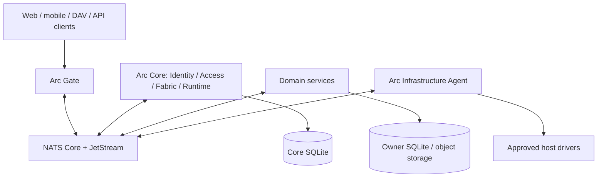

# Arc Architecture

> Requirements: [REQUIREMENTS.md](REQUIREMENTS.md). Setup and checks: [DEVELOPMENT.md](DEVELOPMENT.md).
> This document defines contracts; a planned contract does not establish implementation or verification.

## 1. Purpose and boundaries

Arc is a self-hosted collaboration platform derived from applicable [Kuayle](https://github.com/carbogninalberto/kuayle) concepts. It covers tasks, calendars, contacts, files, pages, Mail connection foundations and planned IMAP synchronization, agents, connectors and workflows. HTTP, DAV, RPC and tools share the same authorization model.

One modular Go Core owns Identity, Access, Fabric and Runtime state. Modules call Go interfaces within Core; separate processes communicate over NATS. Gate is the public API ingress. NATS, databases and the infrastructure Agent remain private. Large files use private HTTP streaming behind Gate or approved object URLs rather than NATS payloads. Bootstrap infrastructure operates independently of Runtime Control.



The diagram includes planned components; [service inventory](../services/README.md) records current executable boundaries. [Core](../services/core/README.md) uses explicit migrations and signed local bootstrap.

## 2. Process and data ownership

| Component | Owns | Boundary |
|---|---|---|
| Core Identity | Users, sessions, workspaces, memberships, groups, service accounts and delegations | No domain content |
| Core Access | Resource types, ACL roots, grants and policy revisions | Domain owner still verifies object/root binding |
| Core Fabric | Approved contracts, instances, capabilities and signed routes | Not an obligatory RPC proxy |
| Core Runtime | Desired state, operations, observations and management policy | No host runtime socket |
| Gate | Public HTTPS ingress, authentication, routing and limits | No database or independent permission authority |
| Infrastructure Agent | Approved host effects and observations | No arbitrary shell/Compose or authority to grant user access |
| SDK | Transport, typed RPC/events, contract enforcement and lifecycle | No domain models or trust in client identity fields |
| Domain service | Its objects, tables, migrations and policy enforcement | No SQL access to another owner |

Core, Task, Files, Pages and Notify each use a separate local SQLite file through GORM. Each owner has **one current baseline migration** with a distinct owner ID; old histories are rejected instead of silently imported or reinterpreted. Core modules share one file and may join transactions. Gormigrate runs explicitly before traffic; startup AutoMigrate is forbidden. Mount only the owner's directory, including WAL/SHM. Gate has no database. Redis is not a required source of truth.

## 3. Identity, service accounts and delegation

Actor identity, authenticated process caller and delegated authority are separate. Broker authentication alone does not authorize a platform operation.

### 3.1. Principals and tenancy

| Entity | Rule |
|---|---|
| User | Global human account, active/disabled; personal resources survive workspace departure |
| Workspace / Membership | Isolated corporate scope; owner/admin/member/guest role and active state |
| Group / GroupMember | Access principal within one workspace; a Task Team is a separate business concept |
| ServiceAccount | Technical identity bound to an approved definition/deployment; no implicit user ACL |
| ServiceCredential | Account key with `kid`, public key, state and rotation overlap; private key stays outside SQL |
| AgentIdentity | Explicit owner and execution scope; tool permission does not grant resource access |
| Session / RefreshFamily | Live server state supporting logout, rotation, reuse detection and revocation |
| Delegation | Grantor consent to a grantee, bounded resources/actions, expiry and approval conditions; does not change ACL |

M0 does not support workspace groups on personal resources or cross-workspace sharing. Autonomous services need explicit grants; acting for a user additionally requires valid delegation.

### 3.2. Credential boundaries

| Surface | Credential | Verification |
|---|---|---|
| Browser | Opaque session cookie, `HttpOnly; Secure; SameSite=Lax`, plus Origin/CSRF checks | Online Identity session state |
| External API | Access JWT, `aud=gate`, `sid`, `jti`; rotating refresh family with hashed tokens | Signature, expiry and live session |
| NATS connection | Scoped NKey/JWT credentials and TLS | Broker subject permissions; NATS JWT is distinct from Arc invocation JWT |
| Internal RPC | Core-signed invocation JWT plus caller request proof | Recipient verifies proof; Identity/Access check live authority |

Passwords use Argon2id. Authentication/recovery/credential changes are audited without secrets; rate limits are required. Refresh reuse revokes the family and requires interactive authentication. Session and refresh state are excluded from workspace export. MFA/SSO/SCIM and dynamic NATS user/JWT issuance are later work.

New accounts can register only with an email-bound workspace invitation. Account,
password/recovery hashes, membership, invitation consumption, workspace revision
and success audit commit in one Core transaction. Redemption rechecks the live
workspace and issuer authority; existing accounts use invitation acceptance after
sign-in. Public self-registration without an invitation is disabled. Registration
returns a recovery code once, stores only its hash and creates no session. A lost
response cannot replay that code; the user should try signing in before retrying.

Core, Gate and Agent broker credentials and TLS roots are provisioned independently through operator-managed secret files. Bootstrap must not depend on a running Identity service to connect to NATS.

### 3.3. Invocation and request proof v1

Core uses EdDSA/Ed25519. Protected internal JWKS publishes public verification keys only; SDK rejects `alg=none` and algorithm substitution. Gate and domain services never receive the Core signing private key.

Required claims: `iss=arc-core`, `aud=<service>/v<major>`, `sub=<user|agent|service>:<uuid>`, `caller`, `op`, `iat`, `nbf`, `exp`, `jti`, `cnf.kid`. Optional claims include `sid`, `delegation_id`, `on_behalf_of` and `workspace_id`. Workspace context is not a grant; `on_behalf_of` requires delegation. Payload/headers cannot select trusted actor, caller or scopes.

Defaults: access JWT ≤10 minutes; invocation ≤60 seconds; client assertion ≤30 seconds with one-use `jti`; one-off delegation defaults to 24 hours and may be shortened by policy. These are initial limits, not measured SLOs.

Gate exchanges an active session through `identity.v1.invocations.exchange_user` for one approved target operation. Services use `identity.v1.invocations.exchange_service` with a registered-key assertion (`iss/sub=service-account-id`, `aud=identity.exchange_service`). `op` must match both envelope and approved contract. Propagation presents the incoming invocation and obtains a fresh downstream token: actor provenance is preserved, audience/caller change, and scope can only narrow. Autonomous service identity is not a human session.

NATS Micro monitoring does not attest the publisher of an individual request. Untrusted identity headers cannot replace proof. `proof_v1` is an Ed25519 signature over the UTF-8 RFC 8785 canonical JSON array:

```text
["proof_v1", subject, request_id,
 hex_lower(SHA-256(JCS(envelope without proof))), token.jti, timestamp, nonce]
```

Signature encoding is unpadded base64url. Timestamp is RFC3339Nano with a −30/+5 second window; nonce length is 16–128 characters. Verify subject, request/body, caller key and live key state. Persist nonces for all protected calls, including reads, until token expiry +30 seconds. Mutation idempotency is separate from nonce replay protection. Never accept a verification key from an untrusted request field.

### 3.4. Delegation and revocation

Only an authenticated grantor or explicitly authorized trusted consent workflow may create delegation. An agent/service cannot delegate to itself for a user. Creation verifies the grantor's current rights. Store grantor, grantee kind/ID, actions, resource scope, expiry, revocation, creator and consent method. Expanding scope requires new consent.

Each protected operation intersects current user ACL, delegation, approved service rights and allowed agent tools. `needs_approval` operations are denied without confirmed approval. Missing Identity/Access fails closed with `UNAVAILABLE`; M0 has no positive authorization cache.

Session, delegation, membership and credential revocations commit with audit/revision. Checks beginning after commit must observe revocation even while a JWT remains valid. In-flight work may finish; long jobs reacquire short-lived credentials and check each side effect. Workspace departure preserves personal resources. Full dangerous-action approval classes belong to M5.

### 3.5. Identity APIs and storage

The current internal implementation is `services/core/modules/identity`; public auth is in Gate. Session operations, service/user invocation exchange, delegation operations and public-key lookup have explicit caller policy. Local methods for users/workspaces/groups/service accounts are not automatically public APIs; product administration and approved Gate APIs remain [#9](https://github.com/pavlith/arc/issues/9).

Identity stores users, password hashes, sessions, refresh families/token hashes, workspace principals, service public keys, agents, delegations, signing-key metadata, assertion/proof nonces, command results and audit. Enforce one membership per workspace/user, same-workspace groups, unique account/key IDs and persistent anti-replay. Private keys, NKey seeds, refresh plaintext, passwords and OAuth secrets must not appear as plaintext SQL values or logs. Initial user/recovery bootstrap is local, not public RPC.

## 4. Resource registry and ACL

Core owns identity/access metadata; domain services own content and enforce decisions for every ingress protocol. Gate authorization does not replace recipient authorization.

### 4.1. ACL roots

Register only independently permissioned roots: personal/workspace roots, calendars, address books, Files/Pages sections, agents and workflows. Ordinary tasks/events/files/pages may reference a root without a registry row. `business_parent` and `acl_parent` serve different purposes.

| Storage | Rules |
|---|---|
| Resource types | Namespace, provider, approved digest, actions and inheritance policy |
| Resources | UUID, type/provider, `owner_kind=user|workspace`, owner/workspace, optional parent, inheritance flag, lifecycle, policy revision |
| Grants | Resource, principal kind/ID, action, optional expiry, creator; allow-only |
| Operations | Idempotency key, request hash, operation, resource, state and result |
| Policy audit | Verified actor/delegation, change, resource and revision; no secrets |

Personal roots may have no workspace; workspace roots require `owner_id=workspace_id`. One acyclic ACL parent must share owner/scope in M0. `inherit_acl=false` stops ancestor grants without changing ownership or system safeguards. Sharing adds a grant rather than moving ownership. Root reparenting/ownership transfer is outside M0. Workspace group/role grants stay in the same workspace; M0 personal sharing targets individual users.

Core creates the corporate `arc.workspace` root, the workspace, its owner membership and both audit records in one SQLite transaction. The root shares the workspace UUID and carries no domain permissions. The registry uses a disabled internal identity for the provider foreign key. Domain providers still own their content roots and use the existing reservation and activation protocol. An owner can archive a workspace. The transaction revokes memberships and pending invitations, removes group assignments and closes the corporate root. Subsequent Access checks deny workspace-scoped roots. Domain data and personal roots are retained.

### 4.2. Check algorithm

Actions are exact contract-defined strings. `calendar.free_busy` does not imply `calendar.read`; ACL management does not imply content read/download. Fabric validates operation/action mappings.

1. Verify invocation claims, target operation, caller proof/key and live Identity state. Unverified calls are `UNAUTHENTICATED`.
2. The domain owner resolves the actual object/root/workspace relationship from its database. A client-supplied accessible root cannot authorize an unrelated object.
3. Require an active root, valid ownership/scope and parent chain.
4. Resolve live principals in the resource workspace. Collect matching unexpired direct/ancestor grants up to the inheritance boundary.
5. A personal owner receives the type's permitted owner actions. Workspace owners/admins may manage corporate ACL, but need an explicit content grant to read/download. Authorized ACL managers can explicitly self-grant, with audit: M0 does not promise confidentiality from an administrator who can grant access. `share` grants only the initiator's existing actions and cannot grant ACL management. Owner recovery is a separate privileged audited procedure.
6. Intersect delegated user rights, consent, agent tools and approved service actions. Autonomous services use explicit grants. Broker permissions provide an additional boundary. Otherwise deny; M0 has no deny-grants or positive cache.

Signed downstream `source_aud/source_op` derive from the verified incoming invocation. Exact `DownstreamFrom/DownstreamActions` prevent `free_busy → Access.Check` from becoming read, even for a resource owner. Clients cannot select provenance at exchange.

Policy denial yields `PERMISSION_DENIED` or contract-defined concealing `NOT_FOUND`; an unavailable authority yields `UNAVAILABLE`/HTTP 503. New checks after revoke commit see the change; immediate cancellation of in-flight work is not promised. Streaming and collaborative editing require later rechecks.

### 4.3. Access v1

| Operation | Contract |
|---|---|
| `resource_types.register` | Approved contract/provider only; no public installation endpoint |
| `resources.reserve` | Verified provider/actor, owner/parent and idempotency key; returns reserved UUID |
| `resources.activate` / `abort` | Same provider; activate after committed domain binding; safe replay |
| `resources.begin_delete` / `finalize_delete` | Authorization, deletion confirmation, audit and revision |
| `check` | Verified actor, resource/action → allowed/revision |
| `check_many` | At most 100 pairs from one consistent policy snapshot |
| `list_accessible_roots` | Paginated owner/workspace/type/action filtering without hidden metadata |
| `grants.add` / `revoke` | ACL management or bounded share authority; transaction, audit/revision; revoke optionally binds `resource_id` to the grant's actual root |
| `grants.list` | Paginated direct unrevoked/unexpired grants for one root; live ACL management authority and policy snapshot; no implicit/inherited rights |
| `principals.validate_users` | Batched active user/membership and target-action checks in one root snapshot; requires the invocation-approved actor action; returns validity only |

Names use `access.v1.*`; concrete RPC subjects follow §5.3. Check payload contains resource/action, not trusted actor/caller. Listings also apply domain filters. Use batched checks rather than N+1 RPC. Denial diagnostics are limited to trusted auditors.

### 4.4. Cross-database root lifecycle

1. Provider reserves a root after actor/parent authorization; repeated identical input returns the same ID, changed input conflicts.
2. Provider commits its object/root binding and outbox locally while keeping it unpublished.
3. Access verifies the provider's committed receipt and activates the root; the provider then exposes the object and publishes the pending event.
4. Provider reconciliation retries incomplete transitions; an uncommitted expired reservation may be aborted. Timeout alone never deletes an active root.
5. `begin_delete` blocks new access; provider deletes/archives idempotently and finalizes. Retention governs physical cleanup.

There is no distributed SQL transaction. Every step must tolerate crash and replay.

### 4.5. Required security cases

| Case | Expected result |
|---|---|
| Leave workspace A while belonging to B | A corporate access ends; personal/B resources survive |
| Free/busy without read | No titles/attendees |
| ACL admin without content grant | Can manage ACL; cannot download until an explicit audited grant |
| Inheritance disabled | Ancestor grant excluded; owner/scope unchanged |
| Foreign object with an accessible root | Domain binding check rejects |
| Agent lacks delegation or current user rights | Denied |
| Forged JWT/caller/proof/body, wrong audience/op, replay | No effect; safe error/audit |
| Session/key/membership/grant/delegation revoked | New checks deny despite unexpired JWT |
| Self-issued delegation or replayed service assertion | Denied |
| Access unavailable | Fail closed without cached allow |

Minimal M0 guardrails are mandatory; exhaustive automation belongs to M7 (§10). Cross-workspace/group sharing of personal data, public links, root transfer and streaming revoke require later contracts and tests.

## 5. Service Fabric and SDK

Arc uses one root Go module, `github.com/pavlith/arc`. `sdk/transport` is an Arc-native, deliberately narrow NATS service transport using `nats.go` for connections, request/reply, JetStream and TLS/NKey. It implements the public Micro v1 PING/INFO/STATS monitoring protocol and queue endpoints; it is not a wrapper or fork of the whole upstream `nats.go/micro` package. Domain handlers use approved SDK composition, not raw transport endpoints.

### 5.1. Catalog and instance lifecycle

| Entity | Meaning |
|---|---|
| ServiceDefinition | Stable logical service/publisher and installation policy |
| ServiceContract | Immutable approved manifest, API major, schemas/resources/actions/events/exposure and digest |
| ServiceInstance | Ephemeral process identity, build version, digest, readiness and lease |
| RouteSnapshot | Monotonic atomic revision of approved routes, independent of live containers |

An operator-signed installation binds publisher, service account/deployment, deterministic artifact digest and exact subjects. Fabric commits contract, Access types, revision and audit atomically. One active digest per service/API major prevents incompatible handlers sharing a queue. Replacement requires revocation and conservative same-major compatibility: preserve existing operations/auth/responses/events; optional request fields may be added. Breaking changes require a new major. No business allowlist fallback exists when the live catalog is unavailable.

Startup: scoped broker connection → authenticated `ctl.arc.fabric.register` → approval → install all required handlers → local self-check, signed instance probe and exact Micro INFO/queue verification → `.ready`. Assertions use distinct audiences, full request proof and persistent replay checks. Core control responses are signed and bound to request ID/subject/expiry. Lease is 30 seconds, heartbeat 5 seconds; each business RPC checks live approval/lease. Reconnect repeats registration/readiness. Revocation or failed control closes processing. Discovery text alone is not proof; missing responders produce `UNAVAILABLE`, not contract deletion.

### 5.2. Manifest v1

An install artifact contains manifest and local JSON schemas. Digest covers the canonical manifest and sorted canonical schema paths/hashes, not arbitrary YAML formatting. Reject unknown manifest fields, external/file schema loaders, namespace/action/route collisions and executable selectors. Schemas define their own required fields and `additionalProperties` policy.

Operations declare stable ID, query/command kind, exact subject, request/response schema, auth action/root selector, size/timeout/idempotency and optional HTTP/tool/workflow exposure. Exposures default off independently. Root/workspace selectors are restricted paths, not code; the domain owner verifies the actual binding. Approval cannot invent unknown resource actions.

```yaml
manifest_version: 1
service: {name: calendar, build_version: 1.0.0, api_major: 1}
resources:
  - {type: calendar, actions: [read, create, update, delete, share, manage]}
operations:
  - id: calendar.events.create
    kind: command
    subject: rpc.calendar.v1.events.create
    request_schema: schemas/calendar.events.create.request.v1.json
    response_schema: schemas/calendar.events.create.response.v1.json
    auth: {action: calendar.create, resource_from: payload.calendar_id}
    idempotency: required
    timeout_ms: 10000
    http: {expose: true, method: POST, path: "/api/v1/calendars/{id}/events", success_status: 201}
    tool: {expose: false}
events:
  - {name: calendar.event.created, subject: evt.calendar.event.created.v1, schema: schemas/calendar.event.created.v1.json}
```

This is a contract illustration; Calendar is not implemented. Gate bindings must explicitly map HTTP fields to payload selectors.

### 5.3. RPC, subjects and delivery

```text
rpc.<service>.v<major>.<operation suffix>  # queue q.<service>.v<major>
evt.<service>.<entity>.<event>.v<major>    # durable fanout
ctl.arc.<operation>                      # explicit bootstrap/control policy
ctl.runtime.v1.node.<node-id>.<operation>  # closed node protocol, §7.2
```

Domain subjects use fixed approved tokens; resource/user/workspace IDs belong in payload. The node ID is an explicit, provisioned exception for private Runtime subjects. Wildcard `$SRV.>` access is restricted to monitoring/admin identities.

RPC v1 JSON carries `request_id`, `operation`, `schema_version`, `deadline_at`, optional `idempotency_key`/`traceparent`, invocation `auth`, `proof` and typed `payload`. Reply contains the same request ID and either `data` or `error{code,message,retryable}`. Input/output schema validation is required.

| Error | HTTP |
|---|---|
| `UNAUTHENTICATED` / `PERMISSION_DENIED` / `NOT_FOUND` | 401 / 403 / 404 |
| `VALIDATION_ERROR` / `CONFLICT` / `RATE_LIMITED` | 400 / 409 / 429 |
| `UNAVAILABLE` / `DEADLINE_EXCEEDED` / `INTERNAL` | 503 / 504 / 500 |

Expose safe messages, never SQL, stacks or secrets. HTTP success status comes from the approved route. Query timeout defaults to 5 seconds, command to 10 seconds; effective deadline is the smaller caller/contract budget. UTF-8 envelope and response limits are 256 KiB. Reject invalid versions before execution.

Commands atomically store actor/operation/key, request hash, result, mutation, audit and outbox. Retain replay ≥24 hours; changed payload conflicts. Validate response before commit. Clients retry an uncertain timeout with the original key; SDK/Gate never silently issue a new-key mutation retry. External side effects do not have an exactly-once guarantee.

Events include stable `event_id`, type/version, aggregate ID, occurrence time and trace, with minimal nonsecret metadata. Publish committed outbox using a stable JetStream message ID. Durable consumers atomically commit inbox deduplication and internal effects, then ACK. Retry with backoff; after five deliveries copy to `dlq.<approved-event-subject>.<durable>` before completing the original. Event/DLQ permissions and Fabric permits are explicit. An event subscription grants no resource read authority. Long work uses asynchronous jobs (`202`/job ID), not a held RPC.

Downstream `incoming_api_major` defaults to 1 and must match the incoming signed audience and approved source operation/action map. It cannot change identity or expand authority.

Fabric retains at most 32 immutable compiled artifacts, keyed by a SHA-256 of
the complete manifest and schema map. Each lookup still verifies the operator
signature, active installation and current Identity/Access state. This bounds
repeated schema compilation during multi-domain reads without caching grants.

Cross-domain resource references use a closed signed read edge: exact source
resource operation, target read operation/action and user actor only. The
initial targets are Task work GET, Files metadata GET (personal/workspace) and
Pages GET (personal/workspace). Each edge requires an explicit installation
rule with exact DownstreamFrom/DownstreamActions; no wildcard or mutation is
accepted. Identity preserves workspace/session provenance. Target owners check
live ACL and actual object/root binding. Read summaries contain only authorized
ID/title/revision; cross-workspace references are initially denied. A stored
reference never grants access. See [resource integration](RESOURCE-REFERENCES.md).

### 5.4. Routes and versioning

Fabric validates method, normalized path and major, including static/parameter/wildcard collisions. System prefixes such as `/api/v1/arc/*`, `/health*` and `/dav/*` cannot be captured by domain contracts. Runtime announcements do not create public routes.

Snapshot wire format is `SignedSnapshot{payload,signature}`. Payload includes revision, issued time, `kid`, digest, routes/bindings and artifacts. Digest is SHA-256 of canonical `{routes,artifacts}`; Ed25519 signature covers canonical `["arc.route_snapshot.v1", payload]`. Reject rollback or equal revision with a different digest; identical revision/content is replay-safe. Older unsigned/non-domain-separated forms are rejected.

`ctl.arc.fabric.routes` uses signed-service assertion/proof and exact `fabric/v1:fabric.v1.routes` bootstrap policy. A separately pinned RouteTrustKey signs request-bound `RouteBundle(snapshot, active JWKS, request_id, expires_at, signature)` with domain separator `arc.route_bundle.v1`. Snapshot kid must be a live Identity verification key. Large route bundles optionally carry the same signed snapshot as gzip bytes, authenticated by the outer request-bound signature. Compressed data is limited to 128 KiB and expanded snapshot JSON to 1 MiB; Gate rejects ambiguous/corrupt encodings and verifies the original Identity signature/digest after bounded expansion. Ordinary RPC remains limited to 256 KiB. Upgrade Core and Gate together for this encoding. Gate does not trust reply publisher or unsigned change hints; hints trigger authenticated fetch and periodic reconciliation repairs missed notifications.

Gate atomically swaps immutable validated tables. Cold start serves no dynamic routes before a valid snapshot; a bad update retains the previous table while online auth remains mandatory. Signed HTTP bindings are scalar `{source:path|query,name,field,type}`; reject missing path bindings, unknown query keys, body collisions and authority fields. Body is a JSON object. Validate response before HTTP delivery. Commands cannot use GET/HEAD. Build SemVer and API major are distinct; incompatible handlers never share a queue.

### 5.5. SDK API boundaries

Actual packages: root `sdk` for App/bootstrap transport, `sdk/transport`, `sdk/service`, `sdk/module`, `sdk/client`, `sdk/rpc`, `sdk/contract`, `sdk/events`, `sdk/security`, `sdk/agent` and optional `sdk/telemetry`. Core owns Identity, Access and Fabric. See [SDK README](../sdk/README.md).

Protected handler pipeline: verify invocation/proof → validate schema → resolve domain ownership/root → online ACL → effect → response validation/observation. Manifest configuration cannot disable security checks. Private bootstrap/health operations use explicit separate policy. Typed bindings use package helpers (`sdk.Handle`, `sdk.HandleCommand`, `module.BindQuery/BindCommand`); workers start after readiness.

## 6. Gate and protocol adapters

Gate is the public HTTPS boundary and owns **no database**. It accepts trusted proxy headers only from configured CIDRs, applies bounded timeouts/rates, caps HTTP bodies at 200 KiB within the 256 KiB RPC envelope, and exposes separate liveness/readiness probes. Missing upstream authority fails closed.

Browser authentication uses `/api/v1/arc/auth/{login,refresh,logout,session}`: Secure/HttpOnly/SameSite=Lax `__Host-` session and refresh cookies, same-origin/allowed-Origin checks and CSRF on mutations. No browser Bearer tokens. CLI uses `/api/v1/arc/cli/{token,refresh,logout}` without Origin or cookies and with independent token rotation. Mixed credentials are rejected; Bearer validation requires a current Core session and `aud=gate`.

Invited registration is restricted to `/api/v1/arc/auth/register-invited` with allowed Origin, rate limits, signed `identity.v1.sessions.register_invited` Gate-only invocation and one-time recovery code (no-store). Invitation tokens stay in URL fragments/UI memory, never in logs or cookies. Public recovery requires a one-time code, always rotates the recovery secret and revokes sessions. Wrong credentials return indistinguishable authentication errors.

Reserved `/api/v1/arc/identity/` routes map only to explicitly operator-approved `identity.v1.product.*` RPCs. Core verifies the actual Gate service account, signed assertion/proof, live browser user, membership and administrator policy **inside mutations before replay**. Account status/provisioning needs signed installation `AdminUsers` authority, never workspace-admin privilege; disabling revokes sessions and invitations, re-enabling never restores them. Profile/preference/password/session operations are self-scoped, revisioned and subject to live authorization. Credential changes do not persist secrets in replay records.

Task root discovery separates current `task.read` and `access.grants.manage` authorization; only bounded root IDs and permission flags are exposed. Flags and workspace slugs are navigation metadata, not authority. Invitation listings require current workspace owner/admin. Workspace slug resolution requires current membership and returns immutable UUID/root bindings; renamed slugs do not create automatic redirects.

All protected requests exchange an operation-/audience-bound invocation and fresh proof. Domain services recheck root binding, current ACL, replay and request integrity. Preserve request/trace IDs, deadlines and idempotency; never cache ACL in a route snapshot. Missing responder is unavailable; deadlines and authority outages fail closed. The signed manifest and implementation are authoritative for exact route payloads.

After request-schema validation, a signed `workspace_from` selector may resolve to
an explicit empty string for personal scope when the schema permits it. Missing
or non-string values fail validation. Resource selectors remain nonempty; Core
and the domain owner still verify the actual root and workspace binding.

The optional Gate `/api/v1/arc/realtime` WSS adapter is implemented but disabled by default. It requires live browser Origin/session/CSRF, exact private event subscriptions and metadata-only invalidations with authorized refetch; see [Realtime](REALTIME.md). DAV remains a planned Gate adapter with the same ACL, revocation, opaque storage and protocol-specific validation. Browser auth is not a DAV credential.

## 7. Runtime Control and Infrastructure Agent

Runtime is an infrastructure control plane for trusted nodes, including independent VPS. Agent initiates private outbound TLS/NKey NATS; no second gRPC transport or public Docker/LXD API is introduced. Docker/LXD/systemd are separate typed drivers. A type in the SDK does not establish a working driver; explicit target nodes do not imply a scheduler. Arc service readiness still requires Fabric.

Current executable capabilities and limitations are maintained in [Agent README](../services/agent/README.md) and [services](../services/README.md). [#13](https://github.com/pavlith/arc/issues/13) tracks remaining M6 integration. M0 requires the safe contract/fake-provider baseline, not live Docker management; implementing a limited Agent early does not complete M6.

### 7.1. Data and management boundary

Core owns nodes, approved templates, typed resources/deployments, immutable revisions, operations, receipts, observations, audit and hint outbox. Operation states are pending/running/succeeded/failed/cancelled. Desired state is running/stopped/deleted. Observations and Fabric instances are distinct: host running/health does not prove approved API readiness. Secrets remain references.

`runtime.Control` implements `sdk/agent.RuntimeProvider`. Enable it with both trusted `RuntimeControlPolicy` and `RuntimeSnapshotSigningKey`; partial configuration fails and default Control is nil. Manager policy requires live `arc.runtime.manage` for a verified nondelegated Arc admin; Node policy derives service identity from trusted context. DTOs cannot choose actors. Storage additionally checks active user/node/service bindings. Administrative policy and Gate adapters are not implemented.

`RegisterNode` binds a node permanently to one active `arc-agent` service account and capabilities; disabled nodes cannot be resurrected. Template revisions are immutable and revocation irreversible. Core approval does not install the node's independent local allowlist.

`Apply` accepts revision zero/empty template digest, expected revision and idempotency key. Core assigns current template digest and next revision, committing resource/operation/revision/audit/outbox together. Resource node/kind binding is immutable; deletion leaves a tombstone. Actor-scoped replay rechecks authorization; changed payload conflicts. New revision cancels prior pending/running operations and preserves terminal history. Only approved typed Runtime resources can produce host execution snapshots.

### 7.2. Node protocol and snapshot execution

| Invocation (`aud=runtime/v1`) | Subject suffix under `ctl.runtime.v1.node.<node-id>.` |
|---|---|
| `runtime.v1.node.inventory` | `inventory` |
| `runtime.v1.desired.get` | `desired.get` |
| `runtime.v1.node.report` | `report` |

`RuntimeNodeRPC=true` requires Control and installs Core's actual Identity verifier. Exact signed bootstrap rules allow only these service-actor operations without business actions/downstream. They cannot expose management or arbitrary control subjects. Require self-service identity `sub=service:<caller>`, without session/workspace/delegation/upstream claims. Verify invocation/proof, persistent nonce, live account/node/policy, subject/payload node and resource ownership. Assertions alone are insufficient. Network identity overrides any custom local Node policy.

Agent broker permissions allow only its three subjects and Identity service exchange; reply subscriptions are restricted to `_INBOX.runtime.<node-id>.>` through SDK InboxPrefix. Core binds active nodes at startup; new enrollment needs restart, while disable/key/policy revoke is live. Partial binding aborts startup. NodeClient fixes node identity and deadlines ≤5 seconds. Report retry preserves event ID with a fresh proof nonce.

Inventory returns own resource IDs, including tombstones, in pages of 100: hints, not execution authority. Pull returns only current resource/operation and approved template for the active node. Snapshot v1 binds fresh request ID (16–128 characters), operation, node, issued/expiry ≤30 seconds and typed Spec. Ed25519 signs RFC 8785 bytes with `arc.runtime.snapshot.v1\n` domain separation. Verify pinned Core key, request/node/expiry, monotonic revision, template ID/revision, driver kind and SHA-256 digest of the complete canonical template. SpecDigest also uses RFC 8785. Reject unknown fields even with a valid signature; no shell, raw env, mounts or arbitrary command fields.

Operator-installed templates use immutable Docker `@sha256:` image, local LXD fingerprint or exact preinstalled systemd unit. LXD/systemd allow one replica. Bootstrap targets are forbidden. Driver ownership, dependencies and host policy remain mandatory after template validation.

Before an effect, persist revision, spec digest and operation ID. Reject lower revision or changed content/operation at the same revision. A completed replay returns saved observation unless an Inspector rechecks host state; drift repair requires a fresh online snapshot and retains durable intent. Incomplete intent may retry only after new pull. Drivers must tolerate crash after effect/before result, honor snapshot-bounded context/cancellation, and retain data on delete. Journal errors forbid effects.

Reports bind node/service, event/operation/revision/spec digest and approved template. Success requires matching desired/observed replicas, not inferred Fabric readiness. Commit report receipt, observation, operation, node liveness and audit together. Exact duplicate changes nothing; altered duplicate or new stale report is rejected. Management reads require live policy and pagination. Hint outbox contains resource/node/revision/operation on `.changed`; publisher and Core reconciler remain unimplemented.

### 7.3. Reconciliation and failures

Agent runs serial online inventory/pull rounds with bounded backoff. Missing inventory IDs do not request deletion. No new effects occur from cached commands when Core/NATS is unavailable; existing workloads survive. Reports are persisted before their first send; pending retries preserve event ID across reconnect and process restart, and host effects remain idempotent. New successful observations refresh liveness. Failed operations are terminal and require explicit new desired revision; a complete health channel after terminal operations is still absent.

The standalone Linux Agent owns a private durable, exclusively locked journal. SIGTERM/SIGINT close connections/journal without stopping workloads. Its current systemd driver operates only root-owned, preinstalled `arc-managed-<resource-id>.service` with matching template ID. Fixed show/start/stop calls reject aliases, drop-ins, unsafe dependencies and noncanonical ownership/path. Delete stops while retaining unit/data. Installation, enable/restart and unit edits remain operator work. The Docker driver manages approved, locally available images on the node's Unix socket and persists container ownership before effects. Current restrictions and verification limits are in the [Agent README](../services/agent/README.md). LXD is not implemented.

Target Core reconciliation uses a lease/single active owner; stale operations cannot overwrite newer revisions. Failures produce bounded retry, Degraded/Failed and safe codes rather than endless restarts. Docker recovery must independently verify deployment ownership, not adopt by label alone. M6 may use single-node recreate with downtime; rollback/zero-downtime need migration compatibility evidence. Never purge volumes automatically.

### 7.4. Bootstrap and privilege boundary

SQLite, NATS/JetStream, Core, Gate, root credentials and Agent itself are independently provisioned bootstrap. Runtime may observe them but cannot reinstall, delete or reconfigure them. Only nondelegated Arc admins with `arc.runtime.manage` manage infrastructure; workspace-admin and agent/workflow permissions do not imply it.

Only Agent accesses the privileged runtime API. Compromise may compromise the host; ordinary Docker is not a hostile-code isolation guarantee. Managed containers require approved immutable images; deny privileged mode, host PID/network/IPC, runtime sockets, devices, arbitrary host binds/capabilities/entrypoint/env/ports. Templates bound CPU/RAM/PIDs/disk, user, dropped capabilities, seccomp/AppArmor and network policy. Secret/config changes create new revisions; secret values never enter events/logs. Public ingress remains Gate; host port publishing defaults off. Hostile plugins require stronger VM/microVM isolation.

### 7.5. Milestones and checks

M0: schema/interfaces, fake Agent, signed snapshots, replay/revision/template/bootstrap guardrails and independent bootstrap contract. Live Docker, UI installation and scheduling are not M0 requirements.

M6: integrated single-node Docker lifecycle, approved templates, desired/observed reconcile, protected node transport, admin Gate/UI and safe retained volumes; typed LXD/systemd and trusted VPS support use the same boundary and are accepted separately. Require an executed happy path and critical privilege denials per implemented driver. Full replicas, crash/offline/reconnect, stale/spoofed requests, recovery and secret-leak matrices belong to M7. Multi-node placement, automatic rollback and zero-downtime remain beyond the baseline.

## 8. Domain services and tools

| Owner | Scope / contract |
|---|---|
| Task | Teams, workflow, projects, work items, views, templates, scoped grants and resource links; [Task](TASK-MODEL.md) |
| Files | Owner-local file/folder metadata, quotas, resumable bytes and private signed mTLS stream; [Files](FILES.md) |
| Pages | Personal/workspace Tiptap tree, versions, restore and referenced resources; [Pages](PAGES.md) |
| Notify | Per-user Inbox, approved subscriptions, transactional hints and optional signed HTTPS webhook; [Notify](NOTIFY.md) |
| Calendars / Contacts | Independent calendar/address-book owners and iCalendar/vCard objects under the same ACL; DAV adapters planned; [Calendar](CALENDAR.md), [Contacts](CONTACTS.md) |
| Mail | Personal account settings, sealed credentials, live folders, message summaries, MIME metadata and private downloads and current-user TLS checks; content sync/cache and background authority planned; [Mail](MAIL.md) |
| Agents / Workflows / Connectors | Bounded approved tools, durable events, delegation and external credentials; [Requirements](REQUIREMENTS.md) |

Each domain process owns its SQLite schema and transactional replay/outbox; no cross-owner SQL or implicit grants. A task attachment, avatar or page reference is an opaque pointer **not** a permission; target title/preview/bytes require a fresh actor-scoped target read and exact signed invocation edge. Cross-root moves are rejected, archives deny content at the next check, and failure to resolve policy fails closed. [Resource references](RESOURCE-REFERENCES.md) define those checks.

File bytes never travel over NATS. Files private Gate streaming checks Core proof/ACL before and during transfers, enforces offset/digest/quotas and cancels on revoke. Durable orphan cleanup never deletes an object referenced by any catalog state. [Files](FILES.md) specifies the implementation limits and operator setup.

Task root grants require live `access.grants.manage`, correct bound workspace/root and principal validation, plus stable command replay. Grant listing is a separately signed management operation and never follows from content read alone; a grant cannot authorize its own escalation. See the actual [Task model](TASK-MODEL.md) and approved domain manifests.

Notify never trusts event fields to select recipients. The approved consumer checks producer/digest/subject/durable and live target read; inbox rows, dedup, optional outbound intent and realtime hints commit before ACK. Webhook delivery is at-least-once with durable keys, fenced leases, HMAC, bounded retry and no target content. Default outbound remains disabled; [Notify](NOTIFY.md) defines its exact channel contract.

Mail owns personal account creation/discovery, connection settings and encrypted
credentials in its own SQLite. Public creation binds the owner to the verified
user and persists its prepared root/request binding before Core activation; a
current-user retry completes an interrupted transition without a second root.
Discovery uses Core accessible roots and a final batched live read check.
Explicit current-user metadata batches populate a local occurrence index with
account/folder/UIDVALIDITY/UID binding, tombstones and durable window cursors.
Metadata, cursor, audit/replay and minimal outbox hints commit together after
network I/O and live ACL checks; local reads recheck current authority/fences.
Autonomous/full-mailbox synchronization and body caching remain planned. Its
adapter performs bounded TLS authentication, LIST, message summaries,
MIME structure queries and private content downloads under current user invocation
and online Access, with post-network revision/ACL
checks. Sealed submissions prevent plaintext credentials or password verifiers
from entering generic replay. Operator host/port/CIDR policy and TLS validation
bound external connections. See [Mail](MAIL.md) for the implemented contract.

Background jobs/coverage cursors, MIME caches and noninteractive synchronization
remain planned. External IMAP will remain authoritative for messages and flags;
cached reads/streams require current Core authorization. Raw MIME/attachment bytes
use approved private mTLS streaming behind Gate, not NATS payloads. Mail-to-Files
exports and Notify consumption require separate approved contracts.

Mail background synchronization requires separately approved revocable account
consent and a noninteractive Core/service authorization contract, bounded jobs
and generation/lease fencing. It cannot reuse a saved browser session or saved
positive ACL decision. Credentials use write-only management, encrypted storage
and a separately provisioned key; secret hashing/replay, OAuth binding/rotation
and key recovery need concrete contracts before implementation. A design entry
does not enable these permissions or a general connector vault. See [Mail](MAIL.md).

Runtime host management has a separate signed node boundary; ordinary workspace roles cannot become infrastructure administrators. Domain availability, successful compilation and tests do not imply installation or M7 readiness.

## 9. Storage, observability and resilience

Use owner-local SQLite with WAL, foreign keys, 10-second busy timeout, explicit Gormigrate history and complete-transaction retry on SQLITE_BUSY. Obtain write locks before reading mutable policy/domain state. Independent SQLite file replicas or network filesystems do not provide shared state; same-owner processes may share one local file. Gate may replicate independently.

Back up using SQLite backup API or stop the owner while preserving committed WAL, plus objects, secrets and relevant JetStream state. Workspace export is not disaster recovery. Online authorization cannot fall back to a saved snapshot during Core outage. Jobs require leases or idempotent distribution.

Required diagnostics include safe structured logs, request/trace IDs, operation latency/errors, auth/ACL denial, delivery lag and desired/observed health. The M0 [diagnostic baseline](DEVELOPMENT.md#diagnostics) correlates nested RPCs, Agent reconciliation and JetStream publication/inbox processing. Correlation metadata grants no authority and does not change signed input, replay keys or transaction boundaries. Full health/log reporting and the M7 matrix remain separate. Never log payloads, credentials or secret env. Do not turn M0 into a general policy engine, scheduler or plugin platform.

## 10. Verification policy

### 10.1. Readiness levels

| Level | Evidence |
|---|---|
| Implemented | Builds; empty-DB migration and principal path run manually or through a test client |
| Integrated | Connected to Arc, observable, passes focused smoke and required boundary guardrails |
| Verified | Full relevant M7 unit/integration/contract/E2E/security/recovery matrix executed |

M0–M6 need Integrated for their accepted scope; production requires Verified. A narrow tested subsystem does not promote the entire platform. Code absent from the checkout has no current readiness claim.

### 10.2. Required M0–M6 checks

Four distinct protections are necessary: Gate authenticates browsers/CLI and applies CSRF; the RPC verifies service caller, audience and signed operation; the domain verifies actual root ownership and current ACL; mutation/replay/outbox/inbox are atomic. Repeating the *same* check inside one trusted process is unnecessary. Batch `Access.check_many` within a single current policy snapshot instead of N+1 RPCs; never cache positive permission across requests or after a revoke. Load/chaos/compatibility suites belong in the release tier.

Use formatting/static analysis and focused build/tests for affected code, empty-DB/replay for migrations, schema/manifest validation for changed contracts, and one changed-path smoke. Documentation-only work does not trigger builds/tests. Add meaningful regression coverage for an actual defect.

Never defer invocation/proof vectors; ACL deny/revoke/cross-root; migrations; idempotency/outbox/inbox atomicity; digest/version/route collision; Runtime privilege/template boundaries; or one login → Gate → domain → Access → DB → event/consumer path. Prefer a short deterministic loop; do not rerun unrelated successful checks without cause.

### 10.3. Testability and deferred cases

Use replaceable time/UUID/network/storage/provider adapters, separate domain logic from handlers, version schemas/fixtures, accept stable idempotency keys and provide reproducible seed paths. Tests remain beside code; shared infrastructure belongs in `test/`. Deferred scenarios are recorded in the owning GitHub Issue with ID, preconditions and expected outcome, not a duplicate Markdown backlog.

### 10.4. M7

After M6 feature freeze, execute exhaustive business/unit, permission, browser/accessibility/localization, DAV client, replica/reconnect, crash/soak/load, backup/restore/upgrade and recovery coverage, then rerun release regression after fixes. No new product features except testability work and defect correction. See [requirements §8](REQUIREMENTS.md#8-m7-verification).

## 11. Repository layout

```text
cmd/{arc-core,arc-gate,arc-agent,arc-task,arc-notify,arc-files,arc-pages}/
services/core/modules/{identity,access,fabric,runtime}/
services/{gate,agent,task,notify,files,pages}/
services/<owner>/migrations/
services/<service>/api/
sdk/                       # library in the root Go module
test/                      # shared fixtures and test CLI tools
scripts/                   # verification and operational helpers
deploy/                    # example config, Dockerfiles, explicit migrator
docs/                      # requirements, architecture and development
```

`cmd/arc-core` uses the existing Core composition with strict owner-local bootstrap. Product Identity is available through approved Gate routes. The SvelteKit web app uses Svelte 5 and shadcn-svelte in `client/web/`. Its TypeScript Gate client lives in `client/ts/`. Do not create separate Go modules or reintroduce retired APIs.

## 12. Decisions

Sections 2–10 are normative. Superseded choices and delivery history live in Git history and GitHub Issues, not a parallel decision register.
